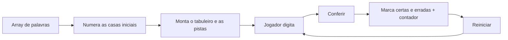

<div align="center">

# 🧩 Cruzadinha de Arquitetura Computacional

[](https://github.com/SEU-USUARIO/NOME-DO-REPO)


### 🎮 [**JOGAR AGORA**](https://SEU-USUARIO.github.io/NOME-DO-REPO/) 🎮

</div>

---

## 📖 Sobre o projeto

Jogo de **palavras cruzadas** que roda direto no navegador, feito para treinar os termos da aula de **Tópicos de Arquitetura Computacional**. Quem joga lê a pista, descobre o termo e digita nas casas do tabuleiro.

Projeto da **Atividade Avaliativa III (Sprint 3)**, feito com **HTML, CSS e JavaScript puros**, sem bibliotecas ou frameworks.

## ✨ Funcionalidades

| Recurso | Descrição |
|---|---|
| 🧱 **Tabuleiro 17×17** | 16 palavras cruzadas entre si |
| 🔢 **Pistas numeradas** | Separadas em Horizontais e Verticais |
| ⌨️ **Digitação direta** | Escreva nas casas; o cursor avança sozinho |
| 🧭 **Navegação por teclado** | Setas e Backspace funcionam |
| ✅ **Botão Conferir** | Verde para o que acertou, vermelho para o que errou |
| 📊 **Contador de acertos** | Ex.: `8 de 16 palavras` |
| 🔄 **Botão Reiniciar** | Limpa tudo e começa de novo |

## 🕹️ Como jogar

1. Leia as pistas nas listas **Horizontais** e **Verticais**.
2. Clique numa casa e digite a resposta (**maiúsculas, sem acento e sem espaço**).
3. Clique em **Conferir** para ver quais palavras estão certas.
4. Use **Reiniciar** para jogar de novo.

> 💡 **Dica:** termos com mais de uma palavra são escritos juntos. Por exemplo, `data bus` vira `DATABUS`.

## 🧠 Termos do jogo

<details>
<summary><b>Clique para ver os 16 termos</b></summary>

<br>

| Nº | Termo | No tabuleiro |
|:-:|---|---|
| 1 | CPU | `CPU` |
| 2 | ULA | `ULA` |
| 3 | UC (Unidade de Controle) | `UC` |
| 4 | Registradores | `REGISTRADORES` |
| 5 | RAM | `RAM` |
| 6 | ROM | `ROM` |
| 7 | EEPROM | `EEPROM` |
| 8 | Flash | `FLASH` |
| 9 | Cache | `CACHE` |
| 10 | Memória de massa (armazenamento) | `MEMORIADEMASSA` |
| 11 | DMA | `DMA` |
| 12 | Address bus (barramento de endereço) | `ADDRESSBUS` |
| 13 | Data bus (barramento de dados) | `DATABUS` |
| 14 | Microcontrolador | `MICROCONTROLADOR` |
| 15 | Dual core | `DUALCORE` |
| 16 | Quad core | `QUADCORE` |

</details>

## ⚙️ Como funciona por dentro

Cada palavra é um objeto no array `palavras` do `script.js`, com a resposta, a posição inicial, a direção e a pista. Todo o resto é gerado a partir dele.

```js
{ r: "ULA", l: 8, c: 11, d: "V", p: "Parte da CPU que faz as contas e as operações lógicas." }
```



## 📁 Estrutura do projeto

```
📦 cruzadinha
 ┣ 📜 index.html   → estrutura da página
 ┣ 🎨 style.css    → visual do tabuleiro e dos botões
 ┣ ⚡ script.js    → lógica do jogo
 ┗ 📝 README.md    → este arquivo
```

## 🚀 Como rodar

**Online:** acesse o link do GitHub Pages no topo da página.

**No seu computador:**

```bash
git clone https://github.com/SEU-USUARIO/NOME-DO-REPO.git
cd NOME-DO-REPO
# abra o index.html no navegador
```

## 🌐 Publicação

O site é publicado como site estático no **GitHub Pages**, em *Settings → Pages → Branch: `main` → Pasta: `/ (root)`*.

## 🎓 O que eu pratiquei

- ✅ Explicar com minhas palavras os conceitos de arquitetura de computadores
- ✅ Construir uma página interativa com HTML, CSS e JavaScript
- ✅ Versionar um projeto com Git, com commits em etapas
- ✅ Publicar um site estático no GitHub Pages

## 👤 Autor

Feito por **SEU NOME** · Disciplina de Arquitetura Computacional

<div align="center">

⭐ Se gostou do projeto, deixe uma estrela! ⭐

</div>
